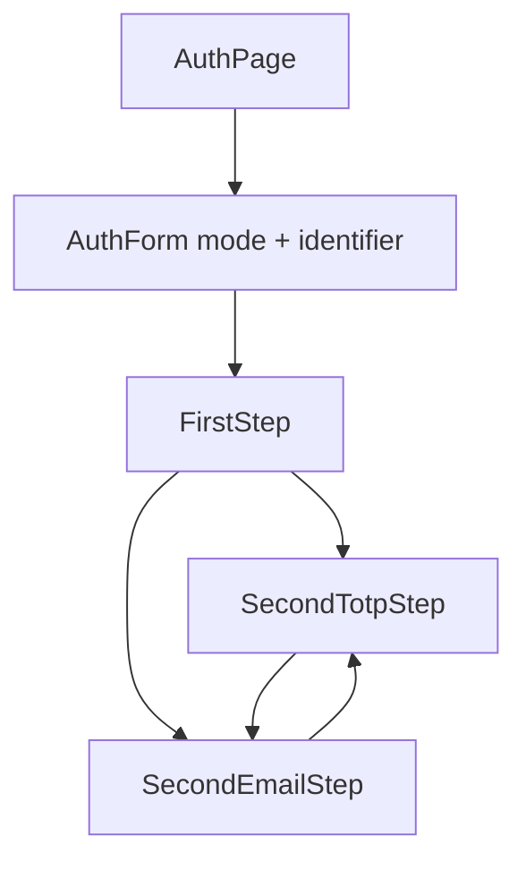
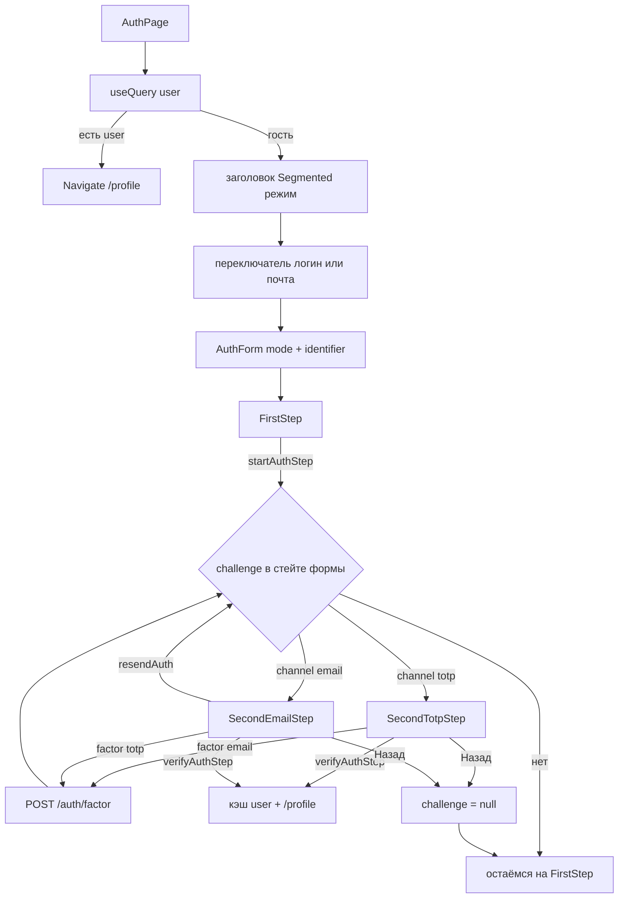
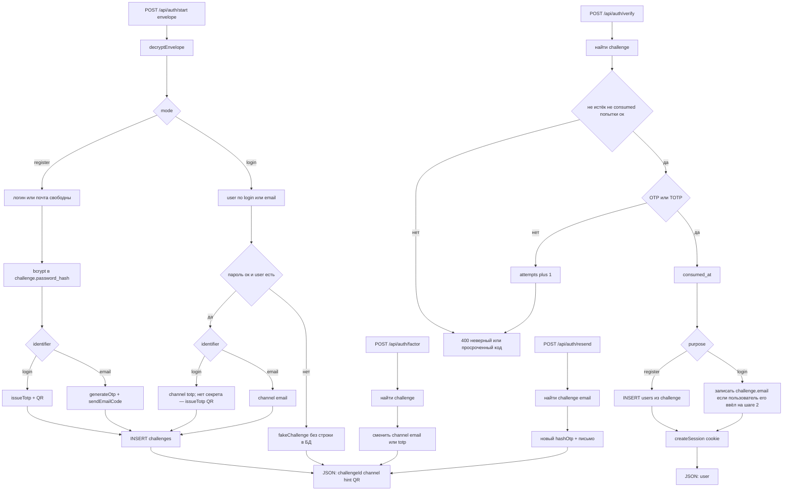

# Auth

Два шага: идентификатор и пароль, затем канал шага 2 (почта или приложение). Страница `[/auth](../src/pages/AuthPage.tsx)` — оболочка: Segmented «Авторизация / Регистрация», переключатель логин или почта. Formik + antd `Form` без вложенного `form`; мутации `fooMutate` / `isFooPending`.

## Потоки

Шаг 1 всегда выбирает идентификатор: **логин+пароль** или **почта+пароль**. Метод шага 2 выбирается уже после шага 1.

### Регистрация

- **Логин/пароль.** Шаг 2 по умолчанию — привязка приложения (QR) и код из него. Почта опциональна: ввод адреса + код на него.
- **Почта/пароль.** Логин выдаёт сервер (`loginFromEmail` в `[server/src/routes/auth.ts](../server/src/routes/auth.ts)`). Шаг 2 по умолчанию — код на эту почту; альтернатива — аутентификатор.

### Авторизация

- **Логин/пароль.** Шаг 2 по умолчанию — код из приложения. Альтернатива: если почта на аккаунте — код на неё; если почты нет — поле email + код на введённый адрес.
- **Почта/пароль.** Шаг 2 по умолчанию — код на почту; альтернатива — код из приложения.

## Диаграмма страницы /auth

## Компоненты

Каталог [`src/components/auth/`](../src/components/auth/) (слайс features): сегменты `ui` / `model`, публичный API — [`index.ts`](../src/components/auth/index.ts).

**Оболочка** — [`src/pages/AuthPage.tsx`](../src/pages/AuthPage.tsx): редирект если `user`, заголовок, Segmented режима, переключатель логин/почта, `key={formKey}` для сброса. Без полей и без `useMutation` старта/верификации.

**ui** — [`AuthForm`](../src/components/auth/ui/AuthForm.tsx); шаги в [`ui/steps/`](../src/components/auth/ui/steps/) (`FirstStep`, `SecondEmailStep`, `SecondTotpStep`); поля в [`ui/base/formFields.tsx`](../src/components/auth/ui/base/formFields.tsx).

**model** — `useAuthForm` / `useAuthChallenge`, Zod-валидация в [`validation.ts`](../src/components/auth/model/validation.ts), типы шагов.

**api** — [`signIn.ts`](../src/components/auth/api/signIn.ts), [`types.ts`](../src/components/auth/api/types.ts) (start / factor / verify / resend).

- `FirstStep` — логин или почта + пароль
- `SecondEmailStep` — код с почты; опционально поле email, если его ещё нет; resend
- `SecondTotpStep` — QR+секрет при enroll; иначе только код

Составные компоненты antd — в [Неявных приёмах](IMPLICIT.md#составные-компоненты).

## Диаграмма сервера

## API

Клиент: [`src/components/auth/api/signIn.ts`](../src/components/auth/api/signIn.ts), типы — [`src/components/auth/api/types.ts`](../src/components/auth/api/types.ts). Сервер: [`server/src/routes/auth.ts`](../server/src/routes/auth.ts), [`server/src/validation.ts`](../server/src/validation.ts), [`server/src/db.ts`](../server/src/db.ts). Тела — зашифрованный конверт.

`POST /api/auth/start`:

- `mode`: `login` | `register`
- `identifier`: `login` | `email`
- `password` + `login` или `email`

Сервер проверяет пароль (вход) или уникальность (регистрация), кладёт `password_hash` в challenge при регистрации, открывает шаг 2 с дефолтным каналом: регистрация/вход по логину — `totp` (QR, если секрета ещё нет); регистрация/вход по почте — `email`.

Ответ challenge: `challengeId`, `channel`, `hasEmail`, `needsTotpEnroll`, `generatedLogin?`, `hint` / `otpauthUrl` / `totpSecret`.

`POST /api/auth/factor`: `challengeId`, `channel` (`email` | `totp`), опционально `email`. Переключает канал без повторного пароля.

`POST /api/auth/verify`: код; заявка `consumed`; на регистрации — `INSERT users` с bcrypt-хешем; `challenge.email` в пользователя только если он задан; TOTP-секрет в пользователя, если канал `totp`.

`POST /api/auth/resend`: новый email-код.

Неверный логин/пароль — fake-challenge: тот же JSON, строки в БД нет.

## Защиты

**Канал и границы**

- Слушаем `127.0.0.1`; `x-powered-by` выключен; Helmet (CORP same-origin).
- CORS только `CLIENT_ORIGIN`, cookie с `credentials`.
- JSON не больше 64 КБ; Zod на входе.
- Не-GET без заголовка `X-Requested-With: LexiRiseBot` — 403 (простая защита от чужого сайта).
- Лимиты: `/api` 80/мин, `/api/auth` 20 / 15 мин.

**Тело запроса**

- Конверт RSA-OAEP-256 + AES-256-GCM; без расшифровки поля не видны.
- В plaintext поле `ts`; старше `PAYLOAD_MAX_AGE_MS` (2 мин) — отказ. Повтор со свежим ключом, если ключ сменился.

**Сессия**

- Cookie `lr_sid`: httpOnly, SameSite=Lax, `secure` в prod.
- В БД только SHA-256 токена, не сам токен.
- Срок `SESSION_DAYS`; профиль и аватар только через `requireUser`.

**Auth и challenge**

- OTP в БД как HMAC-SHA256 с перцем, не открытый код; в ответ клиенту код не едет.
- Почта в ответе маскируется (`a***@x.com`).
- TTL 5 мин, не больше 5 попыток, resend не чаще раза в минуту, заявка одноразовая (`consumed`).
- На `/start` пауза 80–180 мс (сложнее мерить время поиска пользователя).
- Неверный логин/пароль: fake-challenge, тот же JSON, строки в БД нет.
- Пароль: bcrypt, в JSON пользователя не отдаём.

**Файлы**

- Аватар ≤ 2 МБ, один файл; тип по сигнатуре JPEG/PNG/WebP, не по расширению.

## Таблицы БД

SQLite `server/data/users.db`, режим WAL, `STRICT`. Файл: `[server/src/db.ts](../server/src/db.ts)`. Телефона нет.

### users

Аккаунт после успешного `verify`.

| Поле            | Значение                                                                                                                                                                                                                                                                                        |
| --------------- | ----------------------------------------------------------------------------------------------------------------------------------------------------------------------------------------------------------------------------------------------------------------------------------------------- |
| `id`            | UUID. Первичный ключ.                                                                                                                                                                                                                                                                           |
| `login`         | Уникальный. Без учёта регистра. Формат: 3–32 символа, латиница, цифры и `_`.                                                                                                                                                                                                                    |
| `password_hash` | bcrypt-хеш пароля (не сам пароль; cost `BCRYPT_ROUNDS`). Длина пароля до хеша: 8–72 символа. На регистрации пишется из challenge после `verify`. На входе сверяем с введённым паролем. Нет хеша — как неверный пароль (fake-challenge), нужна новая регистрация. В JSON пользователя не отдаём. |
| `email`         | Не длиннее 254 символов, вид `имя@домен`.                                                                                                                                                                                                                                                       |
| `totp_secret`   | base32-секрет аутентификатора для TOTP. `NULL` до привязки: После успешного TOTP-`verify` копируется с challenge в пользователя.                                                                                                                                                                |
| `avatar_blob`   | Байты JPEG/PNG/WebP. `NULL` без аватара.                                                                                                                                                                                                                                                        |
| `avatar_mime`   | `image/jpeg` | `image/png` | `image/webp`. `NULL` без аватара.                                                                                                                                                                                                                                  |
| `created_at`    | unix ms.                                                                                                                                                                                                                                                                                        |
| `updated_at`    | unix ms.                                                                                                                                                                                                                                                                                        |

В профиле нет хеша, секрета и blob; вместо аватара — флаг `has_avatar`.

### challenges

Короткоживущая заявка на второй фактор. После `/start` сервер держит данные шага 1: в `users` рано, на клиенте нельзя. Строка нужна и при регистрации (аккаунт после кода), и при входе (шаг 2 без повторного пароля, сессия по `user_id`).

Неверный логин/пароль — fake-challenge без строки в БД. Живёт до верного `verify` (тогда `consumed`, появляются `users`/`sessions`) либо до истечения TTL. Просроченные и погашенные чистит `cleanupExpired`.

| Поле            | Значение                                                                                                                                                      |
| --------------- | ------------------------------------------------------------------------------------------------------------------------------------------------------------- |
| `id`            | UUID заявки (`challengeId` у клиента).                                                                                                                        |
| `purpose`       | `login` | `register`.                                                                                                                                         |
| `method`        | Текущий канал шага 2:                                                                                                                                         |
| `login`         | Введённый на шаге 1 или собранный из локальной части почты сразу при переходе на шаг 2, до `verify`.                                                          |
| `password_hash` | На регистрации: bcrypt с шага 1, после `verify` копируется в `users`. На авторизации `NULL`: пароль уже сверен с `users`.                                     |
| `email`         | Адрес, на который уходит код, если канал шага 2 — почта (с шага 1, с аккаунта или ввод на шаге 2). `NULL`, если ещё нет.                                      |
| `user_id`       | UUID пользователя, для которого идёт вход: после `verify` по нему создаём сессию и при необходимости пишем почту или TOTP. На регистрации `NULL` до `verify`. |
| `code_hash`     | HMAC-SHA256 email-кода с секретом сервера (перцем): без перца по хешу из БД код не подобрать. Для totp заглушка: код проверяется по `totp_secret`.            |
| `totp_secret`   | Секрет этой заявки (по нему на шаге 2 сверяем код из приложения):                                                                                             |
| `expires_at`    | unix ms, TTL 5 мин (`OTP_TTL_MS`).                                                                                                                            |
| `attempts`      | Число неверных кодов, лимит 5.                                                                                                                                |
| `last_sent_at`  | unix ms последней отправки email-кода, resend не чаще 60 с.                                                                                                   |
| `consumed_at`   | unix ms после верного кода. Иначе `NULL`.                                                                                                                     |
| `created_at`    | unix ms.                                                                                                                                                      |

Индекс `idx_challenges_expires` по `expires_at`: быстрее находить и удалять просроченные заявки.

### sessions

Выданная cookie-сессия после `verify`.

| Поле         | Значение                                                                              |
| ------------ | ------------------------------------------------------------------------------------- |
| `id`         | UUID сессии.                                                                          |
| `user_id`    | UUID пользователя, тот же что `users.id`. При удалении пользователя сессия удаляется. |
| `token_hash` | SHA-256 токена из cookie `lr_sid`, сам токен в БД не хранится. Уникальный.            |
| `expires_at` | unix ms, срок `SESSION_DAYS` (7 суток).                                               |
| `created_at` | unix ms.                                                                              |

Индекс `idx_sessions_user` по `user_id`.

Ошибки Query и неявные приёмы — в [Неявных приёмах](IMPLICIT.md).

## Проверка

В браузере: регистрация по логину (сразу QR, опционально почта), регистрация по почте (дефолт email-код), вход по логину (дефолт TOTP) и по почте (дефолт email-код), «Назад» на шаг 1, переключение канала на шаге 2.